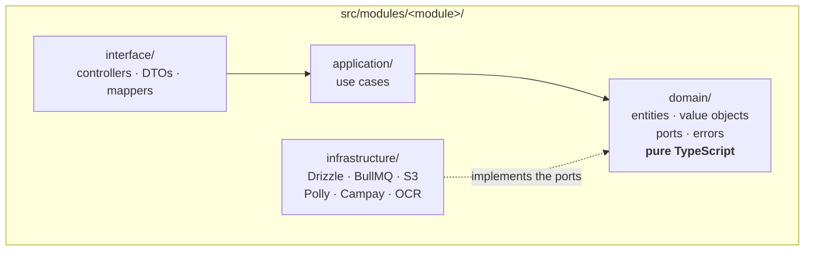
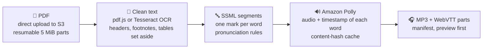
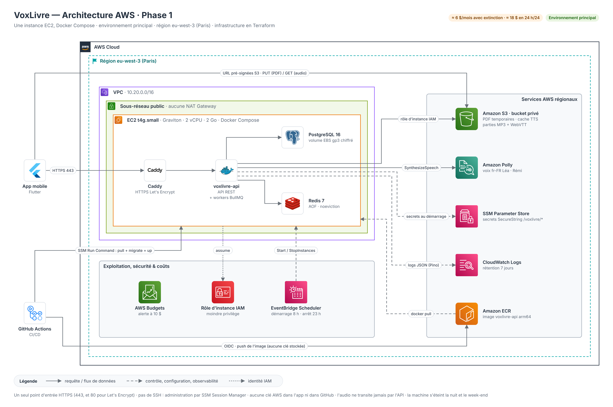
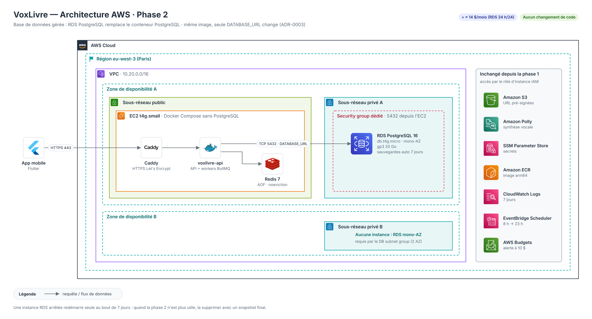
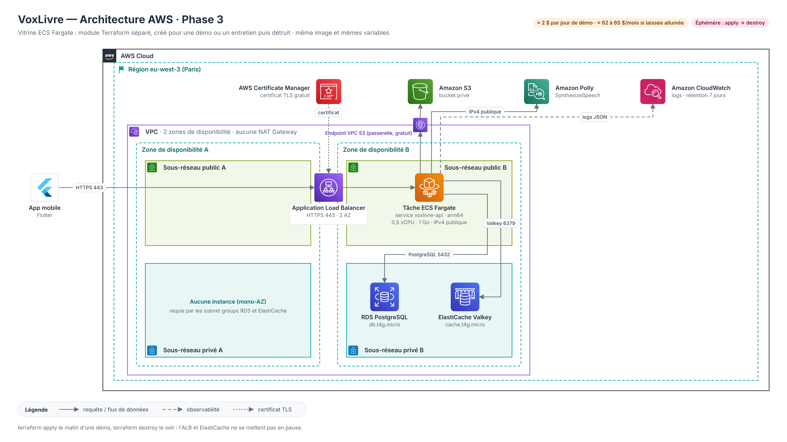

<div align="center">

# 🎧 Voxlivre — Read-Along Audiobook API

**Turn any PDF into a word-synchronised audiobook.**

Production backend of the Voxlivre mobile app: PDF import, text extraction and OCR,
text-to-speech split into downloadable parts, word-level highlighting, multi-device
library and Mobile Money payments — running on a cost-optimised AWS stack.

[](https://github.com/Diderot-sielinou/voxlivreBackend/actions/workflows/ci.yml)


[Problem](#-problem-statement) ·
[Architecture](#-architecture) ·
[AWS](#-aws-infrastructure) ·
[Features](#-features) ·
[Setup](#-installation--setup) ·
[Challenges](#-challenges-faced) ·
[Author](#-author)

</div>

---

## 📌 Problem Statement

In francophone Cameroon, students and readers mostly study from **PDF course notes and
books**, often on a phone, with **unstable mobile connections, expensive data** and
little time to read. Generic text-to-speech apps read one long, flat stream: no way to
follow along word by word, no resume across devices, heavy downloads, and payment
methods (cards, app stores) that most users don't have.

**Voxlivre** lets a user import a PDF and **listen to it while every word is
highlighted** on screen. The backend turns the PDF into clean text (including scanned
documents via OCR), synthesises speech with word-level timestamps, delivers audio in
short parts so listening starts within minutes, keeps the reading position in sync
across devices, and sells listening time through **Orange Money / MTN MoMo**.

## 🎯 Project Goals

- **Start listening fast on a weak network** — direct-to-S3 resumable uploads; audio
  delivered in ~10-minute parts, the first one ready as a ~2-minute preview.
- **Never pay twice for the same work** — every pipeline step is idempotent, and
  synthesised audio is cached by content hash across all users.
- **Produce readable audio from messy PDFs** — strip running headers, page numbers,
  footnotes, captions and tables; restore column order; OCR scanned pages.
- **Charge fairly and safely** — a character-based quota weighted by voice quality,
  reserved before any spending and refunded on failure; payments never trusted on a
  webhook alone.
- **Protect personal data** — the source PDF is deleted after extraction, phone numbers
  are stored as HMACs, no personal data in logs, full account deletion.
- **Stay maintainable by a solo developer** — strict hexagonal architecture enforced by
  the linter, 29 Architecture Decision Records, 900+ automated tests (841 unit, 62 end-to-end, plus integration).
- **Run in production for a few dollars a month** — the whole AWS stack is Terraform,
  deployed by GitHub Actions through OIDC, with the server switched off at night.

## 🛠 Tech Stack

### Backend

| Technology                     | Role                                                                    |
| ------------------------------ | ----------------------------------------------------------------------- |
| NestJS 11                      | Modular monolith, REST API versioned under `/v1`, OpenAPI docs          |
| TypeScript 5 (`strict`)        | Static typing, branded types, discriminated unions                      |
| Drizzle ORM                    | Type-safe SQL, versioned SQL migrations                                 |
| better-auth                    | Passwordless OTP sign-in (e-mail and phone), bearer sessions            |
| BullMQ                         | Background jobs: extraction, OCR, speech synthesis, audio assembly      |
| class-validator + Zod          | Validation of HTTP input, job payloads, provider responses, environment |
| pdf.js · Tesseract 5 + poppler | Native text extraction · OCR of scanned PDFs                            |
| Pino                           | Structured JSON logs with request IDs and PII redaction                 |

### Data

| Technology                 | Role                                                               |
| -------------------------- | ------------------------------------------------------------------ |
| PostgreSQL 16              | Primary database (Docker on EC2 in phase 1, RDS in phase 2)        |
| Redis 7                    | Job queues, rate limiting                                          |
| Amazon S3 (RustFS locally) | PDFs, TTS cache, MP3 + WebVTT parts — accessed via pre-signed URLs |

### External services

| Service        | Role                                                                |
| -------------- | ------------------------------------------------------------------- |
| Amazon Polly   | Neural and standard fr-FR voices, SSML speech marks for word timing |
| Amazon SES     | OTP e-mails (DKIM, SPF, DMARC on `voxlivre.store`)                  |
| Orange SMS API | OTP text messages in Cameroon                                       |
| Campay         | Mobile Money collections (Orange Money, MTN MoMo)                   |

### Infrastructure / DevOps

| Technology                                                                             | Role                                                                                              |
| -------------------------------------------------------------------------------------- | ------------------------------------------------------------------------------------------------- |
| Terraform                                                                              | Entire AWS stack as code (`infra/`)                                                               |
| AWS EC2 Graviton · ECR · SSM · CloudWatch · Route 53 · EventBridge Scheduler · Budgets | Runtime, image registry, secrets and remote commands, logs, DNS, start/stop schedule, cost alerts |
| Docker (multi-stage, arm64) + Docker Compose                                           | Production image and local stack                                                                  |
| Caddy                                                                                  | HTTPS reverse proxy with automatic Let's Encrypt certificates                                     |
| GitHub Actions + OIDC                                                                  | CI and deployment without any stored AWS key                                                      |

### Quality

| Technology                                                       | Role                                                             |
| ---------------------------------------------------------------- | ---------------------------------------------------------------- |
| Jest + supertest + Testcontainers                                | Unit, end-to-end and integration tests (real PostgreSQL/Redis)   |
| ESLint (typescript-eslint, import-x, sonarjs, security, promise) | Strict linting, hexagonal boundary rules                         |
| Prettier · Husky · lint-staged · commitlint                      | Formatting, Git hooks, Conventional Commits with mandatory scope |
| gitleaks · shellcheck · `terraform validate`                     | Secret scanning, script and IaC checks in CI                     |

## 🏗 Architecture

A **modular monolith** with a strict **hexagonal (ports & adapters) architecture**
([ADR-0001](docs/adr/0001-hexagonal-architecture.md)). Each business module has four
layers, and the dependency rule is **enforced by ESLint**: the build fails if the
domain imports NestJS, Drizzle or any provider SDK.



| Module         | Responsibility                                                                    |
| -------------- | --------------------------------------------------------------------------------- |
| `identity`     | OTP authentication, sessions, profile, account deletion                           |
| `notification` | OTP delivery by SMS and e-mail, anti-abuse caps, HMAC fingerprints                |
| `document`     | Upload, extraction, OCR, text cleaning, table of contents, page corrections       |
| `billing`      | Weighted units, monthly free tier, passes, credits, reservation and refund        |
| `conversion`   | SSML segmentation, speech synthesis, audio cache, MP3 + WebVTT assembly, manifest |
| `payment`      | Mobile Money payments, verified webhooks, reconciliation                          |
| `library`      | Library view, reading position, bookmarks, deletion through an outbox             |
| `health`       | Liveness and readiness (the template module)                                      |

Modules talk to each other through **ports owned by the consumer** and **exported
façades** — never through another module's tables or repositories. For example,
`conversion` declares a `QuotaPort`; its adapter calls the `ReserveQuotaUseCase`
exported by `billing`, inside the same database transaction that creates the
conversion.

### The audio pipeline



Each arrow is a BullMQ job that can be replayed after a crash at any line without
side effects.

## 🌐 AWS Infrastructure

Region **eu-west-3 (Paris)**, fully described in **Terraform** and deployed by
**GitHub Actions through OIDC**. Three phases share the same Docker image and the same
variables ([ADR-0012](docs/adr/0012-aws-hosting-ec2-then-fargate.md), details in
[docs/architecture/aws.md](docs/architecture/aws.md)).

### Phase 1 — Main environment: one EC2 instance with Docker Compose



A single HTTPS entry point, no SSH (SSM Session Manager), secrets in SSM Parameter
Store, audio served by pre-signed S3 URLs, no NAT Gateway, and the instance switched
off at night by EventBridge Scheduler: **about $6/month**.

<details>
<summary><b>Phase 2</b> — Managed database: RDS PostgreSQL, no code change</summary>



</details>

<details>
<summary><b>Phase 3</b> — ECS Fargate showcase: ALB, RDS, ElastiCache, created for a demo then destroyed</summary>



</details>

Diagram sources (draw.io and SVG): [docs/architecture/diagrams/](docs/architecture/diagrams/).

## 🖥 Features

All routes are documented in Swagger (`/docs`, enabled outside production). Errors use
**RFC 7807 Problem Details** with a stable `code` (e.g. `402 QUOTA_EXCEEDED`).

**Authentication & account**

- Passwordless sign-in by one-time code: `POST /api/auth/email-otp/*`, `POST /api/auth/phone-number/*`
- Per-destination and daily SMS caps against SMS pumping, destinations stored as HMACs
- `GET /v1/me` — current profile · `DELETE /v1/me` — full account deletion (recent sign-in required)

**Documents**

- `POST /v1/documents` — declare an import and get a pre-signed upload URL; the file never transits through the API
- `POST /v1/documents/:id/upload-parts` — resumable multipart upload for large PDFs on unstable networks
- `POST /v1/documents/:id/upload-confirmation` — checks the received file (real size, `%PDF-` signature), then queues extraction
- Native text extraction or OCR for scanned PDFs (page caps, monthly free OCR allowance)
- Deterministic cleaning: running headers, page numbers, footnotes, captions and tables are **set aside, never lost**; multi-column reading order restored
- `GET /v1/documents/:id/pages` · `PUT /v1/documents/:id/pages/:pageNumber` — read and correct the text page by page
- `GET /v1/documents/:id/outline` — table of contents from bookmarks or detected headings
- `POST /v1/documents/:id/review` — mandatory review when OCR confidence is low

**Conversions (text-to-speech)**

- `GET /v1/voices` — four fr-FR voices, standard and natural, with Voxlivre-owned IDs (the provider can change)
- `POST /v1/documents/:id/conversions` — reserves units and starts the pipeline; idempotent for the same text and voice
- `GET /v1/conversions/:id` — status and progress (segments synthesised, parts ready)
- `GET /v1/conversions/:id/manifest` — MP3 + WebVTT parts with signed download URLs, available from the first part

**Library & reading**

- `GET /v1/library` — one entry per book with derived status (`processing`, `ready`, `in_progress`, `finished`…) and progress
- `PUT`/`GET /v1/conversions/:id/position` — multi-device reading position, "most recent wins"
- `GET /v1/documents/:id/bookmarks` · `PUT`/`DELETE /v1/documents/:id/bookmarks/:bookmarkId` — offline-first bookmarks that survive text corrections
- `DELETE /v1/documents/:id` — atomic deletion, storage files erased in the background through an outbox

**Billing & payments**

- `GET /v1/billing/offers` · `GET /v1/billing/account` · `GET /v1/billing/wallet/entries` — offers in FCFA, remaining free tier, pass and credits, wallet history
- `POST /v1/payments` (`Idempotency-Key` header) · `GET /v1/payments/:id` — Mobile Money payment of a pass or credit pack
- `POST /v1/webhooks/campay` — signature-verified notification; the state is always **re-read from the provider**
- Reconciliation every 5 minutes catches lost notifications

**Platform**

- `GET /health` (liveness) · `GET /health/services` (readiness: PostgreSQL, Redis)
- Global rate limiting (fail-open if Redis is down), Helmet, strict CORS, request IDs propagated to every log line

## 📷 Screenshots

The mobile client (Flutter) lives in a separate repository. Public landing page:
**[voxlivre.store](https://voxlivre.store)**.

## 🧰 Installation & Setup

### Prerequisites

- Node.js `>= 22.22.1 < 23` (see `.nvmrc`)
- pnpm 11 (`corepack enable`)
- Docker and Docker Compose

### 1. Clone and install

```bash
git clone https://github.com/Diderot-sielinou/voxlivreBackend.git
cd voxlivreBackend
pnpm install
```

### 2. Configure the environment

```bash
cp .env.example .env
```

The defaults run **everything locally without any AWS account or provider**: a fake
TTS engine produces silence (`TTS_PROVIDER=fake`), OTP codes are printed in the logs
(`OTP_DELIVERY_MODE=log`) and a fake payment provider succeeds without moving money.

### 3. Start the local infrastructure

```bash
docker compose up -d
```

| Service                | Port                       |
| ---------------------- | -------------------------- |
| PostgreSQL 16          | `5433`                     |
| Redis 7                | `6380`                     |
| RustFS (S3-compatible) | `9002` (console on `9003`) |
| DbGate (database UI)   | `8081`                     |

### 4. Run the migrations and start the API

```bash
pnpm migrate:dev
pnpm start:dev
```

- API: http://localhost:8080
- Swagger: http://localhost:8080/docs

<details>
<summary>Import a PDF locally with <code>curl</code></summary>

```bash
# 1. declare the import → returns upload.url and upload.headers
curl -s -H "Authorization: Bearer $TOKEN" -H 'content-type: application/json' \
  -d "{\"title\":\"My course\",\"sizeBytes\":$(stat -c %s course.pdf),\"rightsAttested\":true}" \
  localhost:8080/v1/documents
# 2. upload the file straight to storage with the signed URL
curl -X PUT -H 'content-type: application/pdf' --data-binary @course.pdf "<upload.url>"
# 3. confirm: text extraction starts in the background
curl -X POST -H "Authorization: Bearer $TOKEN" localhost:8080/v1/documents/<id>/upload-confirmation
```

</details>

### Useful commands

```bash
pnpm lint:check          # strict ESLint + hexagonal boundaries
pnpm typecheck
pnpm test                # unit tests (domain, use cases, adapters with in-memory fakes)
pnpm test:int            # integration tests against real PostgreSQL / Redis (Testcontainers)
pnpm test:e2e            # end-to-end tests on the full application
pnpm test:cov            # coverage (minimum enforced in CI)
pnpm drizzle:generate    # generate a migration from the *.schema.ts files
```

### CI/CD

[`ci.yml`](.github/workflows/ci.yml) runs lint, typecheck, unit tests with a coverage
gate, end-to-end and integration tests, build, gitleaks, `terraform fmt` + `validate`
and shellcheck. On the main branch it then **deploys**: the arm64 image is pushed to
ECR through OIDC and the instance updates itself through SSM Run Command (pull,
migrate, restart).

## 🧠 Challenges Faced

**1. Never paying twice for speech synthesis.** A book is split into hundreds of
segments, each billed by Polly, and any worker can crash at any line. Every step reads
the state from the database and only does what is missing; storage keys and job IDs
are deterministic; and audio is cached under a SHA-256 of _engine + voice + SSML_, so
a retry — or another user converting the same text — costs nothing. In real tests,
Polly once returned a **truncated audio stream without any error** (HTTP/2 stream cut
at 10.92 s): the domain now checks that the last word starts before the end of the
audio, and the client is forced to HTTP/1.1.

**2. Keeping word highlighting aligned.** The app highlights the word being spoken, so
every displayed word gets an SSML mark. Pronunciation fixes ("2 500 FCFA", "art. 3",
dates) must change what is _said_ without shifting the marks: `<sub>` made Polly's
marks drift, so each displayed word keeps exactly one spoken form, written after its
mark ([ADR-0026](docs/adr/0026-ssml-pronunciation.md)).

**3. Cleaning real-world PDFs.** Course notes come with running headers, page
numbers, footnotes, tables and two-column layouts — all of which sound terrible when
read aloud. A deterministic, unit-tested cleaner sets those lines aside with a reason
(never deleting them, since the PDF itself is deleted afterwards), with a guard that
keeps a page intact if cleaning would remove more than half of it. Scanned PDFs go
through Tesseract in batches of 10 pages, with limits based on a benchmark on the
production instance (~3.1 s per page).

**4. Payments over Mobile Money.** Payments are asynchronous (the user validates on
their phone), webhooks can be forged, replayed or lost, and the provider's response to
a payment request can itself be lost. Webhooks are treated as signals only: signature
check (algorithm pinned, constant-time comparison), then the state is re-read from
Campay. A pure decision table, shared by webhooks and a 5-minute reconciliation sweep,
applies conditional transitions; an `Idempotency-Key` plus our own external reference
make every retry safe.

**5. Concurrency on a user's balance.** Ten conversions launched at once must not
overspend a wallet. Balances are locked with `SELECT … FOR UPDATE` in a fixed order
(free tier → pass → wallet) to avoid deadlocks, the allocation itself is a pure
function, and an integration test fires ten concurrent reservations at a real
PostgreSQL to prove that exactly the affordable ones pass.

**6. Production on a budget.** The goal was a real production environment for a few
dollars a month: one Graviton instance with Docker Compose, no NAT Gateway, no Elastic
IP (the DNS record is rewritten at boot), HTTPS by Caddy, and EventBridge Scheduler
stopping the machine at night — while keeping a documented path to RDS and Fargate.

## 📚 What I Learned

**1. Hexagonal architecture that holds over time.** Ports owned by the consumer,
adapters as anti-corruption layers, and boundaries checked by ESLint rather than by
discipline. Swapping Google TTS for Amazon Polly ([ADR-0013](docs/adr/0013-tts-amazon-polly.md))
touched one adapter, not the use cases.

**2. Designing for idempotency and failure.** Conditional SQL transitions,
deterministic job IDs, content-addressed caches, the transactional outbox, sweepers
that recover what a queue lost, and asking for every effect: _"if the process dies
right after this line, what does the retry do?"_

**3. Transactions across modules.** A re-entrant Unit of Work built on
`AsyncLocalStorage` lets two modules write atomically without knowing each other —
something a modular monolith gets for free and microservices would need a saga for.

**4. AWS from the ground up, as code.** VPC design without NAT, least-privilege IAM
instance roles, OIDC federation for CI, SSM for secrets and remote commands, SES
domain authentication, and cost control with schedules and budgets — all in Terraform.

**5. Testing at the right level.** Pure functions tested by the hundred in seconds,
use cases with shared in-memory fakes, adapters against real databases with
Testcontainers, and end-to-end tests with network ports replaced — plus tests that
check what must **not** happen (no PII in logs, no second charge, no write after a
refusal).

**6. Writing decisions down.** 29 ADRs written _before_ the code made trade-offs
explicit (and reversible), and turned out to be the best onboarding document.

## 🚀 Future Improvements

1. **ECS Fargate showcase (phase 3)** — the architecture is designed; turn it into a
   Terraform module created for demos and destroyed afterwards.
2. **Domain events** — `EventEmitterModule` is wired but unused; emit
   `conversion.completed` to trigger push notifications ("your book is ready") without
   coupling modules.
3. **Automated module-boundary checks** — ESLint enforces layers; add per-module rules
   (or dependency-cruiser) so that cross-module imports go only through exported
   façades.
4. **Observability beyond logs** — OpenTelemetry tracing and metrics were deliberately
   left out of the MVP; add them once real traffic justifies it.
5. **Richer voice catalogue** — the TTS port makes it possible to add another engine or
   A/B test voices without changing the pipeline.

## 📖 Documentation

| Document                                             | Content                                                                              |
| ---------------------------------------------------- | ------------------------------------------------------------------------------------ |
| [AGENTS.md](AGENTS.md)                               | Non-negotiable engineering rules (architecture, security, tests)                     |
| [docs/adr/](docs/adr/)                               | 29 Architecture Decision Records                                                     |
| [docs/architecture/aws.md](docs/architecture/aws.md) | AWS architecture, costs and security                                                 |
| [docs/code-engineering/](docs/code-engineering/)     | Guides: hexagonal, dependency injection, errors, testing, performance, observability |
| [infra/](infra/)                                     | Terraform: network, compute, storage, IAM, DNS, deployment                           |

## 👨🏽‍💻 Author

**Diderot Sielinou** — Fullstack JavaScript Developer

- 📩 [diderotsielinou@gmail.com](mailto:diderotsielinou@gmail.com)
- 🌍 Based in Cameroon · Open to remote opportunities
- 🔗 [LinkedIn](https://www.linkedin.com/in/diderot-sielinou-930905266)
- 🐙 [GitHub](https://github.com/Diderot-sielinou)
